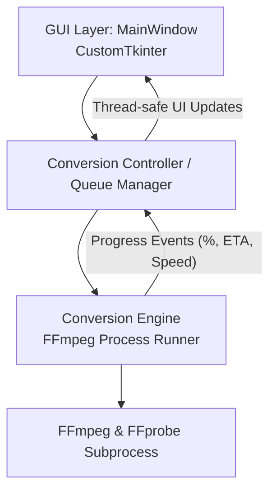

# MKV to MP4 Converter - System Design Specification

**Date:** 2026-11-07  
**Author:** Pair Programming Assistant & User  
**Status:** In Review  

---

## 1. Goal and Overview

The objective is to create a lightweight, high-performance Windows desktop application that converts/remuxes `.mkv` files to `.mp4` format while preserving 100% audio quality, displaying accurate real-time progress bars for each conversion, and shipping as a single, portable `.exe` file.

### Key Constraints and Requirements
- **Audio Preservation (100%):** Zero audio generation loss. Audio streams must be copied losslessly (`-c:a copy`) whenever compatible with the MP4 container (e.g., AAC, AC3, E-AC3, MP3, Opus, FLAC, ALAC). For edge-case incompatible codecs (e.g., TrueHD / raw PCM not supported by container specs), provide seamless fallback to lossless ALAC or maximum-bitrate (320 kbps) copy.
- **Speed & Efficiency:** Default to "Smart Remux" mode (`-c:v copy -c:a copy` when video is H.264/HEVC/AV1). Remuxing operates at disk I/O speed (often 300–800 MB/s, finishing multi-gigabyte files in seconds) with near-zero CPU overhead. Re-encoding is only triggered when explicitly requested or required by codec incompatibility.
- **Progress Tracking:** Precise per-file and queue-level progress tracking. Uses FFmpeg's `-progress pipe:1` or `progress.log` to stream timestamps (`out_time_ms`), computing exact percentage against total media duration, plus real-time processing speed (`speed=X.Xx`) and ETA.
- **Lightweight, Modern UI:** Built with `customtkinter` for a responsive, modern dark-themed GUI.
- **Portable Standalone `.exe`:** Built via PyInstaller into a single executable that bundles required dependencies and locates FFmpeg/FFprobe binaries cleanly.

---

## 2. Architecture & Component Decomposition

The application is decomposed into three isolated, decoupled modules:



### 2.1 Media Engine (`converter/engine.py` & `converter/probe.py`)
- **`probe.py` (`MediaProbe`):**
  - Runs `ffprobe -v quiet -print_format json -show_format -show_streams "<file>"`.
  - Extracts duration in seconds, video codecs (e.g., `h264`, `hevc`, `vp9`), audio codecs (e.g., `aac`, `ac3`, `dts`, `flac`), bitrates, channels, and subtitle tracks.
  - Determines container compatibility: whether video and audio can be remuxed without transcoding.
- **`engine.py` (`FFmpegRunner`):**
  - Constructs optimized FFmpeg arguments:
    - Remux mode: `ffmpeg -y -i "<input>" -map 0:v? -map 0:a? -c:v copy -c:a copy -movflags +faststart -progress pipe:1 "<output>"`
    - Transcode fallback mode (if video incompatible or requested): `ffmpeg -y -i "<input>" -map 0:v? -map 0:a? -c:v libx264 -crf 18 -preset fast -c:a copy -movflags +faststart -progress pipe:1 "<output>"`
  - Executes FFmpeg subprocess with hidden window (`subprocess.STARTUPINFO` flags on Windows to prevent black cmd prompt popping up).
  - Streams stdout asynchronously in a dedicated worker thread, parsing progress lines:
    - `out_time_us=<microseconds>` / `out_time_ms=<milliseconds>`
    - `speed=<float>x`
    - `progress=continue|end`
  - Emits callbacks: `on_progress(percentage: float, elapsed_sec: float, speed_str: str, eta_sec: float)`, `on_log(text: str)`, `on_complete(success: bool, error_message: str | None)`.
  - Supports non-blocking cooperative cancellation (`abort()` terminating process tree cleanly).

### 2.2 Conversion Controller (`converter/controller.py`)
- Manages the conversion queue:
  - Supports single file, multiple files, and recursive folder addition.
  - Generates safe output filenames (e.g. `video.mkv` -> `video.mp4` with collision handling: `video_converted.mp4` if destination exists).
  - State machine per item: `PENDING`, `PROBING`, `CONVERTING`, `COMPLETED`, `FAILED`, `CANCELLED`.
  - Runs conversions on background thread to keep UI thread 100% responsive at 60 FPS.

### 2.3 User Interface (`converter/ui.py`)
- Modern dark/light UI built with `customtkinter`:
  - **Drag-and-Drop Area & File/Folder Pickers:** Easy addition of `.mkv` files.
  - **Queue Listview:** Displays filename, input size, video/audio codec badges (e.g. `H.264 / AAC (Lossless Remux)`), status, and per-file progress.
  - **Active Conversion Card:**
    - Per-file smooth progress bar (0% to 100%).
    - Speed metric (e.g. `Speed: 45.2x`), Elapsed time, ETA countdown.
  - **Overall Batch Progress Bar:** Tracks completed files vs total in queue.
  - **Settings Panel (Collapsible/Drawer):**
    - Output directory selector (defaults to same folder as source file).
    - Audio Preservation Mode: `100% Lossless Stream Copy (Default)` / `Fallback to 320kbps AAC if container rejects`.
    - Video Mode: `Smart Remux (Instant, Lossless)` / `Ensure Compatibility (H.264 transcode if needed)`.
    - Overwrite option / Auto-open output folder upon finish.
  - **Controls:** Start / Pause / Cancel current / Clear queue.

### 2.4 Packaging & Bundling (`build.py` / PyInstaller)
- Resolves FFmpeg / FFprobe runtime binary path:
  1. Internal PyInstaller bundle directory (`sys._MEIPASS/bin`).
  2. Local application directory (`./bin/` or adjacent to `.exe`).
  3. System `PATH`.
- Bundles FFmpeg essentials into single `.exe` (or creates a 1-click builder that downloads static FFmpeg build and packages everything into `dist/MKV_to_MP4_Converter.exe`).

---

## 3. Data Flow & Progress Parsing

1. **User adds file(s)**:
   - UI calls `controller.add_file(path)`.
   - Controller calls `probe.inspect(path)`.
   - UI updates row with duration, stream codecs, and estimated mode (Remux vs Re-encode).
2. **User clicks "Start Conversion"**:
   - Controller starts worker thread on next `PENDING` item.
   - Launches FFmpeg subprocess with `-progress pipe:1`.
   - Standard output parser reads key-value pairs separated by newline:
     ```
     frame=1240
     fps=240.0
     out_time_us=51666667
     speed=10.2x
     progress=continue
     ```
   - Current seconds = `out_time_us / 1,000,000`.
   - Percentage = `min(100.0, (current_seconds / total_duration) * 100.0)`.
   - ETA = `(total_duration - current_seconds) / speed`.
   - Dispatches UI update callback via `root.after(0, ...)`.
3. **On Completion**:
   - Status updated to `COMPLETED`. Output file verified for existence and valid size > 0.
   - Moves to next item in queue.

---

## 4. Error Handling and Edge Cases

- **File in use / permission error:** Caught and flagged in UI with clear error tooltip instead of crashing.
- **Corrupted MKV:** FFmpeg error output captured and reported in detailed log dialog.
- **Audio Codec Incompatibility:** If MP4 rejects a stream during pure copy (e.g. PCM / TrueHD), engine detects error code, notifies controller, and offers auto-fallback to high-bitrate AAC or lossless ALAC without aborting the rest of the queue.
- **User Abort:** Subprocess terminated cleanly with `terminate()` and `kill()` fallback, cleaning up temporary incomplete `.mp4` file.

---

## 5. Testing and Verification Strategy

- **Unit Tests (`tests/test_probe.py`, `tests/test_engine.py`, `tests/test_controller.py`):**
  - Mock FFmpeg/FFprobe outputs to test parsing of duration, codecs, progress lines, speed, and ETA.
  - Verify argument generation for remux mode (`-c:v copy -c:a copy`) and audio preservation.
  - Test queue state transitions and cancellation logic.
- **Integration Test:**
  - Create a short synthetic sample `.mkv` with video and audio tracks.
  - Run conversion engine through remuxing to `.mp4`.
  - Validate output `.mp4` integrity with FFprobe (verifying audio codec and duration match 100%).
- **Build Verification:**
  - Build standalone `.exe` using PyInstaller.
  - Test launch and conversion with the compiled `.exe`.
